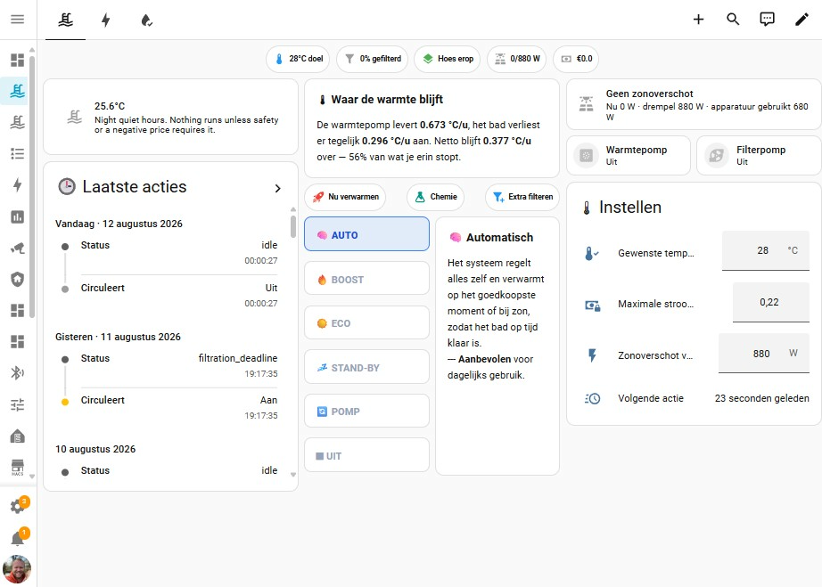

HACS · ESPHome · Home Assistant 2024+

PoolSmart helps Home Assistant manage your pool's filtration, heating, and water treatment.
It schedules filtration, controls compatible heaters, and can use electricity prices and
solar production when planning heating. Every 30 seconds, it checks the pool's current
readings and applies the highest-priority action, while respecting equipment and safety
limits. Optional sensors and price data add features; they are not required for basic use.

> 🤖 **_Disclaimer: Co-written with AI. If your pool turns into a foam party, blame the LLM (or check your pH)._**

[Get started :material-arrow-right:](getting_started.md){ .ps-btn .ps-btn--primary }
[View on GitHub :material-github:](https://github.com/rickertie/Poolsmart){ .ps-btn .ps-btn--secondary }

:material-puzzle: HACS Custom
:material-license: AGPL-3.0-or-later
:material-timer-outline: 30 s decision tick
:material-translate: EN · NL entities

:material-pump:

Smart filtration

Estimates the daily pump run time from pool volume, turnover needs, and available flow data. Updates its estimate as flow changes; heating circulation counts toward the daily total.

:material-heat-pump-outline:

Price- & solar-aware heating

Plans heating against your temperature target and swim time. When configured, it can account for electricity prices, solar power, and a household power limit.

:material-brain:

Self-learning

Refines heat-loss, heating-rate, and heat-pump efficiency estimates from recorded sessions. Review a session before including or excluding it from learning.

:material-test-tube:

Water chemistry

Turns water-test readings into dose estimates for configured products. Test reminders adapt to water temperature, and recorded doses can be reviewed later.

:material-solar-power-variant:

Solar optimization

Can use sunlight or solar-production readings when planning heat. Sunlight data can also help estimate heat loss; the pool does not need its own solar panels.

:material-shield-check-outline:

Equipment protection

Applies configured compressor timing, frost and flow safeguards, and the emergency stop. These protections take priority over scheduled heating.

> 🤖 **Co-written with AI.** If your pool turns into a foam party, blame the LLM — or check your pH.

<figure markdown>
  { width="700" loading="lazy" }
  <figcaption>ESPHome → Home Assistant → Decision Engine → pool equipment. One tick, one winner.</figcaption>
</figure>

---

## Install in two minutes

### Option A — One-click (recommended)

1. Add PoolSmart to HACS:

    

2. Click **Download** in HACS and restart Home Assistant.
3. Add the integration:

    

### Option B — Manual

1. In HACS → **Custom repositories**, add `rickertie/Poolsmart` as **Integration**.
2. Download, restart Home Assistant.
3. Go to **Settings → Devices & Services → Add Integration → PoolSmart**.

!!! note "Unlock all features after install"
    - Map temperature probes and flow meter
    - Choose heating source and target temperature
    - Connect a price sensor for cost optimization
    - See [Hardware](hardware.md) and [ESPHome setup](esphome.md)

<figure markdown>
  { width="700" loading="lazy" }
  <figcaption>Household dashboard (Lovelace) vs maintainer panel at <code>/poolsmart</code> — deliberately separate.</figcaption>
</figure>

---

## Explore the docs

### Start here

**[Getting Started](getting_started.md)** — 15 minutes from fresh install to first verified decision.

### Core concepts

| Topic | Document | Covers |
|---|---|---|
| How decisions are made | [Architecture](architecture.md) | Decision priorities, filtration calculations, and advisory features |
| Heating plans and electricity prices | [Planning](planning.md) | Heating modes, swim-time planning, and price integrations |
| How PoolSmart learns | [Learning](learning.md) | Learned estimates, session checks, and review controls |

### Subsystems

| Topic | Document | Covers |
|---|---|---|
| Filtration | [Filtration](filtration.md) | How PoolSmart estimates run time and accounts for flow and filter media |
| Heating sources | [Heating](heating.md) | What PoolSmart supports for heat pumps, electric, solar, gas, and unheated pools |
| Water treatment | [Chemistry](chemistry.md) | Dose estimates, test reminders, circulation, and dose history |

### Setup & configuration

| Topic | Document | Covers |
|---|---|---|
| Hardware & wiring | [Hardware](hardware.md) | Bill of materials, pinouts, voltage divider |
| ESPHome setup | [ESPHome](esphome.md) | Board configuration, probe calibration |
| Sensor mapping | [Sensors](sensors.md) | Sensor placement, calibration procedures |
| Configuration | [Configuration](configuration.md) | Options flow, entity reassignment, house power limit |
| Pre-filling the wizard | [Defaults](defaults.md) | Starting the wizard with your own figures |

### Reference

| Topic | Document | Covers |
|---|---|---|
| Entity IDs | [Entities](entities.md) | Fixed IDs, translated names, source sensors |
| Management panel | [Panel](panel.md) | Six-tab sidebar panel at `/poolsmart` |
| Lovelace dashboards | [Lovelace dashboards](lovelace/README.md) | Installing and customizing Lovelace dashboards |
| Logging & diagnostics | [Logging](logging.md) | Logbook entries, notifications, full trace |
| Troubleshooting | [Troubleshooting](troubleshooting.md) | Common issues, fault isolation, diagnostics |
| Development | [Development](development.md) | Running tests, contributing |
| Changelog | [CHANGELOG](https://github.com/rickertie/Poolsmart/blob/main/CHANGELOG.md) | Release history |

---

## The management panel

PoolSmart ships a full panel at `/poolsmart` with six tabs: **Overview, Planning, Sessions, Learning, Settings, Diagnostics**.
It visualizes the decision ladder, shows why the last decision was made, and exposes the self-learning engine.
See [Panel](panel.md) for the full reference. For everyday household use, install the [Lovelace dashboard](lovelace/README.md).

---

## Quick links

!!! tip "Where to next?"
    - :material-rocket-launch: **First time?** [Getting Started](getting_started.md)
    - :material-chart-line: **COP & heat loss:** [Self-Learning Engine](learning.md)
    - :material-currency-eur: **Dynamic prices:** [Price-Aware Heating](planning.md)
    - :material-test-tube: **Water quality:** [Automated Dosing](chemistry.md)
    - :material-view-dashboard: **UI layout:** [Lovelace Dashboards](lovelace/README.md)

---

## Known limitations

- **Services can target multiple pools.** Choose the intended pool in a service call; the management panel targets its currently selected pool. See [Troubleshooting](troubleshooting.md#targeting-services-to-a-pool).
- **House power limit needs the right sensor.** The demand limiter expects a whole-house power sensor (e.g. from your smart meter), not the pool's own consumption. See [Configuration](configuration.md#house-power-limit).

---

## License

AGPL-3.0-or-later. See [LICENSE](https://github.com/rickertie/Poolsmart/blob/main/LICENSE) on GitHub.
